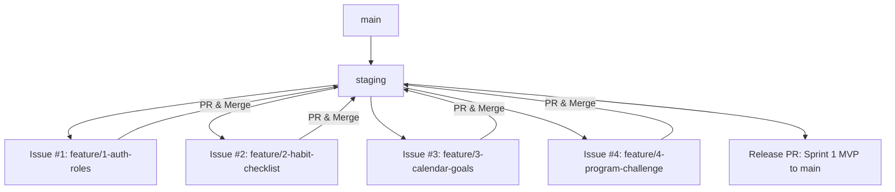

# HabitLess Sprint 1 Engineering Specification

**Document ID**: SPEC-HL-01  
**Version**: 1.4  
**Status**: Approved Architecture & Specification Baseline (Strict MVP Scope)  
**Method**: Spec-Driven Development (SDD)  
**Parent Project**: HabitLess - Habit and Activity Tracking System  
**Source Brief Reference**: `HabitLess App Design: Habit and Activity Tracking System (pp. 1–5)`  
**Scope Boundary**: Strictly High Priority / Low Effort [MVP] Features Only  

---

## 1. Sprint Goal

Deliver a responsive, cloud-ready, end-to-end Minimum Viable Product (MVP) of **HabitLess** (Habit and Activity Tracking System) strictly focused on the **High Priority / Low Effort [MVP]** requirements defined in `HabitLess App Design` (`_lab5_sec31_habitless.pdf`):
* **Participants** can register (Sign up), log in/out, create customizable habits with 8 selectable fixed habit colors (`--blue-energy`, `--ocean-deep`, `--verdigris`, `--yellow-green`, `--amber-gold`, `--amber-glow`, `--cinnabar`, `--cherry-rose`), define target frequencies and dates, view a daily checklist of today's assigned habits and activities with completion toggles, view and interact with the monthly Daily Habit Tracker Calendar desktop (tracking daily completions and editing habits in-calendar), monitor their Goals Tracker (target count vs. achieved count), and add timestamped reflection notes.
* **Program Managers** can create challenge programs with defined start/end dates (e.g., "30-Day Wellness Challenge"), define standardized habits/activities with clear titles, descriptions, and target frequencies (e.g., Daily, 3x/week, Weekdays only), and deploy/publish challenge programs to the web to invite participants.

All features categorized under **High Priority / High Effort**, **Low Priority / Low Effort**, or **Low Priority / High Effort** are explicitly deferred to post-Sprint 1.

---

## 2. Stakeholder Request Interpretation & Role Context

From the stakeholder brief (`HabitLess App Design`, pp. 1, 3–5) and updated color specification:
* **Participant Journey (MVP Scope)**:
  * Simple account sign up and secure login/logout.
  * Today's checklist view displaying today's assigned habits and activities with instant completion toggles.
  * Customizable habit creation: Name, Description, Fixed habit colors (8 vibrant habit palette tokens distinct from website theme tokens), Frequency (every certain day, monthly, weekly), and Start-end dates.
  * **Daily Habit Tracker Calendar Desktop** (`HabitLess App Design`, p. 3):
    * Header bar with month/year navigation (`< March 2021 >`), user account indicator, and `+ New Habit` button.
    * Left column (`HABITS`): Vertical list of tracked habits with in-calendar habit editing.
    * Center grid (`1–31`): Daily columns labeled with day-of-week initials (`M T W T F S S`) and day numbers, containing interactive color-coded checkmarks matching each habit's assigned color.
    * Right column (`GOAL ACHIEVED`): Displays each habit's target count alongside its achieved completion count (e.g., `20 / 19`).
    * Notes section: Located below the calendar grid with timestamped reflection entries and a `+ New Note` action.
  * Goals tracker: Tracking goal achievement counts versus target counts per habit.
* **Program Manager Journey (MVP Scope)**:
  * Create challenge programs with defined start and end dates (e.g., "30-Day Wellness Challenge").
  * Define standard curriculum habits/activities with clear titles, descriptions, and target frequencies (Daily, 3x/week, Weekdays only).
  * Deploy to invite participants via challenges in the web (publishing the challenge and providing a public invitation / join link).

---

## 3. Scope Boundary & Feature Classification

### 3.1. Included Scope: High Priority / Low Effort [MVP] Only

Sprint 1 is strictly partitioned into **four modular feature increments** mapped to distinct Git branches:

1. **Feature 1: Authentication, Role-Based Access & Cloud Health Probes (`feature/1-auth-roles`)**
   * Account registration (Sign up) with role selection (`PARTICIPANT` vs `PROGRAM_MANAGER`).
   * Account login and logout.
   * Secure session management (HTTP-only JWT cookies) and password hashing (bcrypt).
   * Health probe (`GET /api/health`) and database readiness check (`GET /api/ready`).
2. **Feature 2: Participant Habit Creation & Today's Checklist (`feature/2-habit-checklist`)**
   * Customizable habit creation (Name, Description, Fixed habit colors, Frequency, Start-End Date, Target Count).
   * Fixed habit color restriction: 8 selectable habit colors (`--blue-energy`, `--ocean-deep`, `--verdigris`, `--yellow-green`, `--amber-gold`, `--amber-glow`, `--cinnabar`, `--cherry-rose`).
   * Today's checklist view of assigned habits and activities for the current date.
   * Idempotent daily completion logging (check / uncheck toggle).
3. **Feature 3: Daily Habit Tracker Calendar Desktop, In-Calendar Edit & Goals Tracker (`feature/3-calendar-goals`)**
   * Daily habit tracking calendar desktop matrix (Habits on rows, days 1–31 as columns with day-of-week initials, matching `HabitLess App Design`, p. 3).
   * In-calendar daily tracking toggles (interactive color-coded checkmarks using each habit's distinct color).
   * In-calendar habit editing (updating habit name, description, color, frequency, dates, target count).
   * Goals tracker: Displaying each habit's target count alongside its achieved completion count (e.g., `20 / 19`).
   * Notes section below the calendar grid with timestamped reflection entries and a `+ New Note` action.
4. **Feature 4: Program Manager Challenge Creation & Deployment (`feature/4-program-challenge`)**
   * Challenge program creation with defined start/end dates (e.g., "30-Day Wellness Challenge").
   * Definition of habits/activities with clear titles, descriptions, and target frequencies (e.g., Daily, 3x/week, Weekdays only).
   * Deploy to invite participants via challenges in the web: publishing challenge status and generating a public web invitation view (`/challenges/:id`) allowing participants to join.

---

### 3.2. Excluded Scope (Explicitly Deferred per Brief pp. 4–5)

To guarantee a focused, high-quality, working bare-minimum app, all features outside the High Priority / Low Effort [MVP] quadrant are **strictly excluded** from Sprint 1:

* **High Priority / High Effort [DEFERRED to post-Sprint 1]**:
  * Completion Calendar / Heatmap (a monthly or weekly grid showing completed vs. missed days at a glance) (`HabitLess App Design`, p. 4).
  * Statistics per habit (`HabitLess App Design`, p. 4).
  * Total Habits done: Program Completion Bar (`HabitLess App Design`, p. 4).
  * Page with habits from calendar separate (`HabitLess App Design`, p. 4; habit viewing and editing is handled unified within the Daily Calendar and Today's Checklist).
  * See new challenge packages (posted by program manager) (this is a new page) (`HabitLess App Design`, p. 4; full participant marketplace discovery catalog is deferred; MVP supports direct invitation link via web deploy).
  * Statistics of which challenges are popular and which category is popular (`HabitLess App Design`, p. 5).
  * View active roster and remove/deactivate participants if needed (`HabitLess App Design`, p. 5).
* **Low Priority / Low Effort [DEFERRED to post-Sprint 1]**:
  * Bug report form (`HabitLess App Design`, p. 4).
  * Habit progress / Streak (`HabitLess App Design`, p. 4).
  * Highest Streak (`HabitLess App Design`, p. 4).
  * Customizable habit color (`HabitLess App Design`, p. 4; MVP strictly enforces the 8 fixed habit palette colors, rejecting arbitrary color pickers).
* **Low Priority / High Effort [DEFERRED to post-Sprint 1]**:
  * Daily mood tracker calendar (`HabitLess App Design`, p. 4).
  * Reminder notification through email or SMS (`HabitLess App Design`, p. 4).
  * One-click CSV export of participant logs and completion rates for external reporting (`HabitLess App Design`, p. 4).
  * See challenge popularity ranking (`HabitLess App Design`, p. 4).

---

## 4. Functional Requirements (FR)

| FR ID | Feature Area | Description | Priority / Quadrant | Source Citation |
| :--- | :--- | :--- | :--- | :--- |
| **FR-01** | Auth & Roles | The system shall provide a registration form allowing new users to sign up with email, password, full name, and select their role (`PARTICIPANT` or `PROGRAM_MANAGER`). | High / Low [MVP] | `HabitLess App Design`, pp. 1, 4 |
| **FR-02** | Auth & Roles | The system shall authenticate users with valid credentials, reject invalid attempts with standard error responses, and provide a secure logout action. | High / Low [MVP] | `HabitLess App Design`, pp. 1, 4 |
| **FR-03** | Cloud Readiness | The backend shall expose `GET /api/health` and `GET /api/ready` endpoints, returning HTTP 200 when healthy and database-connected, or HTTP 503 if database connectivity fails. | High / Low [MVP] | Cloud-Ready Baseline |
| **FR-04** | Habit Creation | The system shall allow a Participant to create a custom habit specifying Name, Description, Fixed habit color, Frequency rule, Start–end dates, and Target Count. | High / Low [MVP] | `HabitLess App Design`, pp. 1, 4 |
| **FR-05** | Fixed Habit Colors | The habit creation interface shall restrict habit color choices strictly to the 8 fixed habit palette colors: Blue Energy (`#448aff`), Ocean Deep (`#1565c0`), Verdigris (`#009688`), Yellow Green (`#8bc34a`), Amber Gold (`#ffc107`), Amber Glow (`#ff9800`), Cinnabar (`#f44336`), and Cherry Rose (`#ad1457`). | High / Low [MVP] | User Palette Specification |
| **FR-06** | Habit Frequency | The system shall support habit frequencies: Daily, Certain Days of the Week (e.g., Weekdays, 3x/week), Weekly, and Monthly. | High / Low [MVP] | `HabitLess App Design`, pp. 4, 5 |
| **FR-07** | Today Checklist | The Participant dashboard shall display a daily checklist of assigned habits and activities scheduled for the current date, indicating completed vs. pending items. | High / Low [MVP] | `HabitLess App Design`, pp. 1, 4 |
| **FR-08** | Habit Logging | The system shall allow a Participant to toggle (check/uncheck) a habit for a given date, creating or deleting a completion record in the database idempotently. | High / Low [MVP] | `HabitLess App Design`, pp. 1, 3, 4 |
| **FR-09** | Calendar Desktop | The system shall provide a Daily Habit Tracker Calendar desktop displaying habits as rows and month days (1–31) as columns labeled with day-of-week initials (M T W T F S S), with interactive color-coded checkmarks matching each habit's color. | High / Low [MVP] | `HabitLess App Design`, pp. 1, 3, 4 |
| **FR-10** | In-Calendar Edit | The system shall allow participants to select and edit an existing habit's details (Name, Description, Color, Frequency, Dates, Target Count) directly from the calendar desktop view. | High / Low [MVP] | `HabitLess App Design`, pp. 1, 3 |
| **FR-11** | Goals Tracker | The system shall display each habit's target count alongside its achieved completion count (e.g., `20 / 19`) in the right column of the calendar grid and dashboard summary. | High / Low [MVP] | `HabitLess App Design`, pp. 1, 3, 4 |
| **FR-12** | Calendar Notes | The system shall provide a Notes section located below the calendar grid displaying timestamped reflection entries and a `+ New Note` action. | High / Low [MVP] | `HabitLess App Design`, p. 3 |
| **FR-13** | Program Creation | The system shall allow a Program Manager to create challenge programs specifying a program title, description, category, and defined start/end dates (e.g., "30-Day Wellness Challenge"). | High / Low [MVP] | `HabitLess App Design`, pp. 1, 5 |
| **FR-14** | Activity Definition | The system shall allow a Program Manager to define standardized habits/activities within a program, specifying titles, descriptions, and target frequencies (e.g., Daily, 3x/week, Weekdays only). | High / Low [MVP] | `HabitLess App Design`, p. 5 |
| **FR-15** | Web Challenge Deploy | The system shall allow a Program Manager to deploy/publish a challenge program to the web, generating a shareable web invitation link where participants can view and join the challenge. | High / Low [MVP] | `HabitLess App Design`, pp. 1, 5 |

---

## 5. Business Rules (BR)

| BR ID | Rule Name | Specification Details | Source Citation |
| :--- | :--- | :--- | :--- |
| **BR-01** | Role Isolation | Endpoints under `/api/manager/*` require role `PROGRAM_MANAGER`. Endpoints under `/api/habits/*` and `/api/tracking/*` operate strictly on the authenticated participant's private records. Cross-user access is forbidden (HTTP 403). | `HabitLess App Design`, pp. 1, 4, 5 |
| **BR-02** | Fixed Habit Palette Restriction | Habit colors must strictly match one of the 8 predefined habit color hex constants: `#448aff` (Blue Energy), `#1565c0` (Ocean Deep), `#009688` (Verdigris), `#8bc34a` (Yellow Green), `#ffc107` (Amber Gold), `#ff9800` (Amber Glow), `#f44336` (Cinnabar), `#ad1457` (Cherry Rose) or their 8-character `#RRGGBBff` equivalents. Arbitrary hex colors are rejected with HTTP 422. | Habit Palette Specification |
| **BR-03** | Habit Name Constraints | Habit names are required, single-line strings, trimmed of leading/trailing whitespace, minimum 2 characters, maximum 80 characters. | UI Grid Constraints |
| **BR-04** | Description Constraints | Descriptions are optional multiline text, maximum 500 characters. | Data Sanitization |
| **BR-05** | Date Range Invariant | For any entity with start and end dates (habits, challenge programs), `endDate` must be greater than or equal to `startDate`. | Logical Consistency |
| **BR-06** | Idempotent Daily Logging | A completion record is uniquely identified by `(habitId, logDate)`. Checking an already completed habit returns the existing record; unchecking removes the record. Double-logging the same habit on the same day is impossible. | Relational Uniqueness |
| **BR-07** | Password Policy | Passwords must be at least 8 characters in length and hashed using bcrypt prior to persistence. Plaintext passwords must never appear in logs or API responses. | Security Baseline |
| **BR-08** | Program Deployment Lifecycle | A challenge program has statuses: `DRAFT`, `PUBLISHED`, `ARCHIVED`. Deploying a program transitions its status from `DRAFT` to `PUBLISHED`, activating its public web invitation link. | `HabitLess App Design`, p. 5 |

---

## 6. Color Systems & Design Tokens

HabitLess clearly decouples the **Website Theme Palette** (for application shell, headers, panels, cards) from the **Habit Colors Palette** (for habit identification swatches, checkmarks, and badges):

### 6.1. Website Theme Tokens (`HabitLess App Design`, pp. 1–2)
Used for app layout, headers, backgrounds, and general UI chrome:
* `--walnut`: `#724319ff` / `#724319` (App header, primary navigation, primary dark button)
* `--light-coral`: `#d88180ff` / `#d88180` (Accent badges, secondary buttons)
* `--powder-blush`: `#f7b1b0ff` / `#f7b1b0` (Card borders, dividers, subtle highlights)
* `--papaya-whip`: `#feeac7ff` / `#feeac7` (Page canvas background, input backgrounds)
* `--golden-sand`: `#cad182ff` / `#cad182` (Theme gold accent)

### 6.2. Habit Colors Palette Tokens (Selectable Habit Colors)
Used strictly for habit cards, habit swatch selection, calendar row pills, and daily completion checkmarks:

| Token Name | CSS HEX | CSS HSL | SCSS RGB | Usage |
| :--- | :--- | :--- | :--- | :--- |
| `--blue-energy` | `#448affff` / `#448aff` | `hsla(218, 100%, 63%, 1)` | `rgba(68, 138, 255, 1)` | Habit color option (Vibrant Blue) |
| `--ocean-deep` | `#1565c0ff` / `#1565c0` | `hsla(212, 80%, 42%, 1)` | `rgba(21, 101, 192, 1)` | Habit color option (Deep Navy) |
| `--verdigris` | `#009688ff` / `#009688` | `hsla(174, 100%, 29%, 1)` | `rgba(0, 150, 136, 1)` | Habit color option (Teal) |
| `--yellow-green` | `#8bc34aff` / `#8bc34a` | `hsla(88, 50%, 53%, 1)` | `rgba(139, 195, 74, 1)` | Habit color option (Fresh Green) |
| `--amber-gold` | `#ffc107ff` / `#ffc107` | `hsla(45, 100%, 51%, 1)` | `rgba(255, 193, 7, 1)` | Habit color option (Warm Gold) |
| `--amber-glow` | `#ff9800ff` / `#ff9800` | `hsla(36, 100%, 50%, 1)` | `rgba(255, 152, 0, 1)` | Habit color option (Orange Glow) |
| `--cinnabar` | `#f44336ff` / `#f44336` | `hsla(4, 90%, 58%, 1)` | `rgba(244, 67, 54, 1)` | Habit color option (Red) |
| `--cherry-rose` | `#ad1457ff` / `#ad1457` | `hsla(334, 79%, 38%, 1)` | `rgba(173, 20, 87, 1)` | Habit color option (Magenta Rose) |

*(Note: SCSS variables use identical names prefixed with `$`: `$blue-energy`, `$ocean-deep`, `$verdigris`, `$yellow-green`, `$amber-gold`, `$amber-glow`, `$cinnabar`, `$cherry-rose`.)*

### 6.3. Habit Multi-Stop Gradient Tokens
* `$gradient-top`: `linear-gradient(0deg, #448affff, #1565c0ff, #009688ff, #8bc34aff, #ffc107ff, #ff9800ff, #f44336ff, #ad1457ff)`
* `$gradient-right`: `linear-gradient(90deg, #448affff, #1565c0ff, #009688ff, #8bc34aff, #ffc107ff, #ff9800ff, #f44336ff, #ad1457ff)`
* `$gradient-bottom`: `linear-gradient(180deg, #448affff, #1565c0ff, #009688ff, #8bc34aff, #ffc107ff, #ff9800ff, #f44336ff, #ad1457ff)`
* `$gradient-left`: `linear-gradient(270deg, #448affff, #1565c0ff, #009688ff, #8bc34aff, #ffc107ff, #ff9800ff, #f44336ff, #ad1457ff)`
* `$gradient-top-right`: `linear-gradient(45deg, #448affff, #1565c0ff, #009688ff, #8bc34aff, #ffc107ff, #ff9800ff, #f44336ff, #ad1457ff)`
* `$gradient-bottom-right`: `linear-gradient(135deg, #448affff, #1565c0ff, #009688ff, #8bc34aff, #ffc107ff, #ff9800ff, #f44336ff, #ad1457ff)`
* `$gradient-top-left`: `linear-gradient(225deg, #448affff, #1565c0ff, #009688ff, #8bc34aff, #ffc107ff, #ff9800ff, #f44336ff, #ad1457ff)`
* `$gradient-bottom-left`: `linear-gradient(315deg, #448affff, #1565c0ff, #009688ff, #8bc34aff, #ffc107ff, #ff9800ff, #f44336ff, #ad1457ff)`
* `$gradient-radial`: `radial-gradient(#448affff, #1565c0ff, #009688ff, #8bc34aff, #ffc107ff, #ff9800ff, #f44336ff, #ad1457ff)`

---

## 7. Data Changes & Database Design

### 7.1. Database Schema (`server/prisma/schema.prisma`)

```prisma
datasource db {
  provider = "postgresql"
  url      = env("DATABASE_URL")
}

generator client {
  provider = "prisma-client-js"
}

enum Role {
  PARTICIPANT
  PROGRAM_MANAGER
}

enum FrequencyType {
  DAILY
  WEEKDAYS
  THREE_TIMES_WEEKLY
  WEEKLY
  MONTHLY
  CUSTOM_DAYS
}

enum ProgramStatus {
  DRAFT
  PUBLISHED
  ARCHIVED
}

model User {
  id           Int           @id @default(autoincrement())
  email        String        @unique
  passwordHash String
  fullName     String
  role         Role          @default(PARTICIPANT)
  isActive     Boolean       @default(true)
  createdAt    DateTime      @default(now())
  updatedAt    DateTime      @updatedAt

  habits       Habit[]
  dailyNotes   DailyNote[]
  enrollments  ProgramEnrollment[]
  managedPrograms ChallengeProgram[] @relation("ManagerPrograms")

  @@map("users")
}

model Habit {
  id           Int           @id @default(autoincrement())
  userId       Int
  title        String
  description  String?
  colorHex     String        @default("#448aff") // Default to Blue Energy, restricted to 8 habit tokens
  frequency    FrequencyType @default(DAILY)
  daysOfWeek   Int[]         // [1,2,3,4,5] for weekdays (1=Mon..7=Sun)
  startDate    DateTime      @default(now())
  endDate      DateTime?
  targetCount  Int           @default(20) // Monthly target count (mockup: e.g. 20, 25)
  isActive     Boolean       @default(true)
  programId    Int?          // Optional link to challenge program
  createdAt    DateTime      @default(now())
  updatedAt    DateTime      @updatedAt

  user         User          @relation(fields: [userId], references: [id], onDelete: Cascade)
  program      ChallengeProgram? @relation(fields: [programId], references: [id], onDelete: SetNull)
  logs         HabitLog[]
  notes        DailyNote[]

  @@index([userId])
  @@index([startDate, endDate])
  @@map("habits")
}

model HabitLog {
  id           Int       @id @default(autoincrement())
  habitId      Int
  logDate      DateTime  @db.Date
  completed    Boolean   @default(true)
  createdAt    DateTime  @default(now())
  updatedAt    DateTime  @updatedAt

  habit        Habit     @relation(fields: [habitId], references: [id], onDelete: Cascade)

  @@unique([habitId, logDate])
  @@index([habitId])
  @@index([logDate])
  @@map("habit_logs")
}

model DailyNote {
  id           Int       @id @default(autoincrement())
  userId       Int
  habitId      Int?
  noteDate     DateTime  @db.Date
  content      String
  createdAt    DateTime  @default(now())
  updatedAt    DateTime  @updatedAt

  user         User      @relation(fields: [userId], references: [id], onDelete: Cascade)
  habit        Habit?    @relation(fields: [habitId], references: [id], onDelete: SetNull)

  @@index([userId, noteDate])
  @@map("daily_notes")
}

model ChallengeProgram {
  id           Int           @id @default(autoincrement())
  managerId    Int
  title        String
  description  String?
  category     String        // e.g. "Wellness", "Fitness", "Mindfulness"
  startDate    DateTime
  endDate      DateTime
  status       ProgramStatus @default(DRAFT)
  createdAt    DateTime      @default(now())
  updatedAt    DateTime      @updatedAt

  manager      User          @relation("ManagerPrograms", fields: [managerId], references: [id])
  habits       Habit[]
  activities   ProgramActivity[]
  enrollments  ProgramEnrollment[]

  @@index([managerId])
  @@index([status])
  @@index([category])
  @@map("challenge_programs")
}

model ProgramActivity {
  id           Int           @id @default(autoincrement())
  programId    Int
  title        String
  description  String?
  frequency    FrequencyType @default(DAILY)
  targetCount  Int           @default(1)
  createdAt    DateTime      @default(now())

  program      ChallengeProgram @relation(fields: [programId], references: [id], onDelete: Cascade)

  @@index([programId])
  @@map("program_activities")
}

model ProgramEnrollment {
  id           Int       @id @default(autoincrement())
  programId    Int
  participantId Int
  enrolledAt   DateTime  @default(now())
  isActive     Boolean   @default(true)

  program      ChallengeProgram @relation(fields: [programId], references: [id], onDelete: Cascade)
  participant  User             @relation(fields: [participantId], references: [id], onDelete: Cascade)

  @@unique([programId, participantId])
  @@index([programId])
  @@index([participantId])
  @@map("program_enrollments")
}
```

---

## 8. API Contract Summary

Detailed payloads are documented in [`docs/sprint-01/api-spec.md`](file:///c:/Users/Maimoona%20Aziz/OneDrive/Desktop/habitless-webapp/docs/sprint-01/api-spec.md):

| Group | Method | Endpoint | Purpose | Access | MVP Status |
| :--- | :--- | :--- | :--- | :--- | :--- |
| **System** | `GET` | `/api/health` | Cloud health ping | Public | MVP |
| **System** | `GET` | `/api/ready` | Database readiness probe | Public | MVP |
| **Auth** | `POST` | `/api/auth/register` | Register new user (`PARTICIPANT` / `PROGRAM_MANAGER`) | Public | MVP |
| **Auth** | `POST` | `/api/auth/login` | Authenticate user and issue session token | Public | MVP |
| **Auth** | `POST` | `/api/auth/logout` | Terminate session | Authenticated | MVP |
| **Auth** | `GET` | `/api/auth/me` | Fetch active user profile and role | Authenticated | MVP |
| **Habits** | `GET` | `/api/habits` | List authenticated user's habits | Participant | MVP |
| **Habits** | `POST` | `/api/habits` | Create custom habit (8 fixed colors, frequency, dates, target) | Participant | MVP |
| **Habits** | `GET` | `/api/habits/:id` | Get habit detail | Participant (Owner) | MVP |
| **Habits** | `PUT` | `/api/habits/:id` | In-calendar edit habit details | Participant (Owner) | MVP |
| **Habits** | `DELETE` | `/api/habits/:id` | Soft-delete / archive habit | Participant (Owner) | MVP |
| **Tracking** | `GET` | `/api/tracking/today` | Get today's scheduled habit checklist | Participant | MVP |
| **Tracking** | `POST` | `/api/tracking/log` | Idempotent completion toggle for a date | Participant | MVP |
| **Tracking** | `GET` | `/api/tracking/calendar` | Monthly habit matrix (1–31 days, target vs achieved) | Participant | MVP |
| **Tracking** | `GET` | `/api/tracking/goals` | Goals tracker overview | Participant | MVP |
| **Tracking** | `GET` | `/api/tracking/notes` | List timestamped reflection notes for calendar | Participant | MVP |
| **Tracking** | `POST` | `/api/tracking/notes` | Create a reflection note (`+ New Note` action) | Participant | MVP |
| **Challenges** | `GET` | `/api/challenges/:id` | View deployed challenge web invitation details | Public / Authenticated | MVP |
| **Challenges** | `POST` | `/api/challenges/:id/join` | Join challenge via web invite link | Participant | MVP |
| **Manager** | `GET` | `/api/manager/programs` | List programs created by manager | Program Manager | MVP |
| **Manager** | `POST` | `/api/manager/programs` | Create challenge program with activities | Program Manager | MVP |
| **Manager** | `PUT` | `/api/manager/programs/:id/deploy` | Deploy/publish challenge program to web | Program Manager | MVP |

---

## 9. Acceptance Criteria (Given-When-Then)

* **AC-01 (User Registration & Role-Based Routing)**:  
  *Given* an unregistered email address,  
  *When* a user submits the Sign Up form with valid name, password, and selects their role (`PARTICIPANT` or `PROGRAM_MANAGER`),  
  *Then* a new user is created in PostgreSQL with the chosen role, `isActive = true`, an authenticated session cookie is established, and the user is routed to their corresponding role view (`/dashboard` for Participant, `/manager` for Program Manager, or internal `redirect` destination).
* **AC-02 (Authentication & Role Redirection)**:  
  *Given* a registered user with role `PROGRAM_MANAGER`,  
  *When* valid credentials are submitted on the login screen,  
  *Then* authentication succeeds, an HTTP-only session cookie is set, and the user is routed to the Program Manager view (`/manager`).
* **AC-03 (Custom Habit Creation with Fixed Habit Color)**:  
  *Given* an authenticated Participant on the "+ New Habit" modal,  
  *When* they submit a habit with Title "Journal", Frequency "DAILY", Target Count 20, and Color `#ff9800` (Amber Glow),  
  *Then* the habit is created in PostgreSQL and immediately appears in their Today's Checklist and Daily Habit Tracker Calendar with Amber Glow color styling.
* **AC-04 (Habit Palette Color Rejection)**:  
  *Given* a habit creation request containing an arbitrary color `#9C27B0` outside the 8 fixed habit palette colors,  
  *When* the API receives the payload,  
  *Then* the request is rejected with HTTP 422 Unprocessable Entity and an error indicating valid habit palette tokens.
* **AC-05 (Today's Checklist Display & Completion Toggle)**:  
  *Given* an active habit scheduled for today with assigned color `#009688` (Verdigris),  
  *When* the Participant clicks the checklist checkbox for that habit,  
  *Then* an idempotent `HabitLog` entry is saved for `(habitId, today)`, the checkbox turns `#009688` with a checkmark `✓`, and today's completion count increments.
* **AC-06 (Daily Habit Tracker Calendar Desktop Rendering)**:  
  *Given* a participant with active habits and logged completions for March 2026,  
  *When* the Participant views the Daily Habit Tracker Calendar desktop,  
  *Then* the monthly matrix correctly renders habit rows, days 1–31 columns labeled with day-of-week initials (`M T W T F S S`), color-coded checkmarks using each habit's assigned color, and the Right Column displays target count alongside achieved completion count (e.g., `20 / 19`).
* **AC-07 (In-Calendar Habit Editing)**:  
  *Given* an existing habit displayed on the calendar desktop,  
  *When* the Participant clicks "Edit" on the habit row, updates the habit title or color, and saves,  
  *Then* the habit record is updated in the database and the calendar row immediately reflects the changes.
* **AC-08 (Calendar Notes Section & + New Note)**:  
  *Given* an authenticated Participant on the calendar desktop,  
  *When* they click "+ New Note" in the Notes section below the calendar, enter a reflection note, and submit,  
  *Then* a timestamped reflection note is saved and displayed in the notes feed below the grid.
* **AC-09 (Program Manager Challenge Creation & Deployment)**:  
  *Given* an authenticated Program Manager,  
  *When* they submit a new challenge "30-Day Wellness Challenge" with defined start/end dates and activities, and click "Deploy/Publish",  
  *Then* the program status transitions from `DRAFT` to `PUBLISHED`, and a web invitation link is generated allowing participants to join the challenge.

---

## 10. Work Breakdown, Dependencies, and Branch Flow



### Issue Decomposition & Merge Order

#### Issue #1: User Authentication, Role-Based Access & Cloud Health Probes
* **Branch**: `feature/1-auth-roles`
* **Scope**: 
  * Prisma schema initialization: `User` model with `Role` enum (`PARTICIPANT`, `PROGRAM_MANAGER`).
  * Authentication endpoints (`POST /api/auth/register`, `POST /api/auth/login`, `POST /api/auth/logout`, `GET /api/auth/me`).
  * Cloud readiness endpoints (`GET /api/health`, `GET /api/ready`).
  * Sign Up and Login UI views using HabitLess theme tokens.
  * Seed script (`server/prisma/seed.ts`).

#### Issue #2: Custom Habit Creation & Today's Checklist
* **Branch**: `feature/2-habit-checklist`
* **Dependencies**: Issue #1 merged into `staging`.
* **Scope**:
  * Prisma schema addition: `Habit` model with `FrequencyType`, 8 fixed habit color tokens, and target count.
  * Habit CRUD endpoints (`/api/habits`).
  * Daily checklist endpoint (`GET /api/tracking/today`) and idempotent logging endpoint (`POST /api/tracking/log`).
  * Participant Today's Checklist UI with completion toggles and completion count.
  * "+ New Habit" modal form with 8 fixed habit color swatches, frequency selector, and dates.

#### Issue #3: Daily Habit Tracker Calendar Desktop, In-Calendar Edit & Goals Tracker
* **Branch**: `feature/3-calendar-goals`
* **Dependencies**: Issue #2 merged into `staging`.
* **Scope**:
  * Prisma schema addition: `DailyNote` model for reflection entries.
  * Calendar endpoint `/api/tracking/calendar` (1–31 days matrix) and `/api/tracking/goals`.
  * Reflection notes endpoints (`GET /api/tracking/notes`, `POST /api/tracking/notes`).
  * Daily Habit Tracker Calendar Desktop matrix (habits as rows, days 1–31 as columns with day-of-week initials, checkmark cells in habit colors).
  * In-calendar habit edit modal.
  * Right column Goals Tracker (target count vs. achieved count, e.g. `20 / 19`).
  * Notes section below calendar grid with timestamped reflection entries and `+ New Note` action.

#### Issue #4: Program Manager Challenge Creation & Deployment
* **Branch**: `feature/4-program-challenge`
* **Dependencies**: Issue #1 and Issue #2 merged into `staging`.
* **Scope**:
  * Prisma schema addition: `ChallengeProgram`, `ProgramActivity`, `ProgramEnrollment`.
  * Manager endpoints: program creation, activity definition, and deploy/publish (`/api/manager/programs/*`).
  * Program Manager UI: Challenge Program Builder and Deploy action.
  * Web Challenge Invitation landing view (`/challenges/:id`) and join endpoint (`POST /api/challenges/:id/join`).
