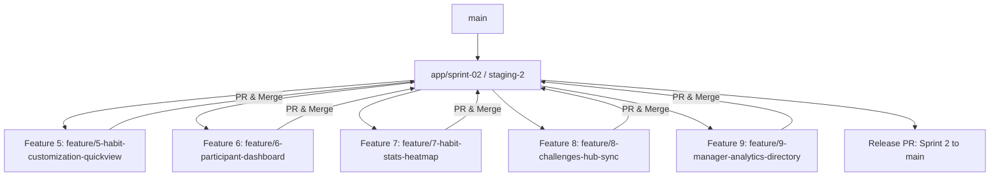

# HabitLess Sprint 2 Engineering Specification

**Document ID**: SPEC-HL-02  
**Version**: 1.0  
**Status**: Approved Architecture & Specification Baseline (Sprint 2)  
**Method**: Spec-Driven Development (SDD)  
**Parent Project**: HabitLess - Habit and Activity Tracking System  
**Baseline Reference**: [`docs/sprint-01/specification.md`](../sprint-01/specification.md) (`SPEC-HL-01`, v1.5)  
**Source Briefs**:
- [`docs/sprint-02/habitless_sprint2_draft.pdf`](habitless_sprint2_draft.pdf) (pp. 1–4)
- [`docs/sprint-01/habitless_sprint1_draft.pdf`](../sprint-01/habitless_sprint1_draft.pdf) (pp. 1–5)

---

## 1. Sprint Goal

Expand the completed Sprint 1 MVP into a full-featured, analytical, and interactive habit and challenge platform across both **Participant** and **Program Manager** roles (`habitless_sprint2_draft.pdf`, Sec. 1):

* **Participants** gain:
  * Read-only **Habit Quick-View Cards** on the tracking calendar (`Back`, `Edit`, and soft-archive `Delete`) and optional **Habit Category Selection** (`Health & Fitness`, `Sleep & Recovery`, `Mindfulness`, `Productivity`, `Learning`, `Finance`, `Social`, `Home`, `Hobbies`, or `Custom`), while preserving Sprint 1's fixed 8-color habit palette (`FR-05` / `BR-02`).
  * A functional **Participant Dashboard** (`/dashboard`) featuring **Today's Focus Snippet** (within a Mon–Sun week strip), **Weekly Habit Progress Bars**, and a global **Program Completion Bar**.
  * An **All Habits Directory** (`/habits`) and **Individual Habit Statistics Page** (`/habits/:id/stats`) featuring a toggleable **Month / Year Completion Heatmap** and **Current / Highest Streak Counters**.
  * An interactive **Challenges Hub** (`/challenges`) with search/filtering, snapshot cloning with a clickable `"Challenge"` badge, leaving/re-enrolling flows (`Keep as Personal Habits` vs. `Remove Habits`), unpublished/republished lifecycle prompts (`Challenge (Ended)` and optional `Sync Changes`), and `1–5` ratings + comments.
* **Program Managers** gain:
  * A **Program Manager Dashboard** (`/manager/dashboard`) displaying platform-wide **Most Popular Challenges** and **Top Categories** analytics.
  * A **Global Challenges Directory** (`/manager/challenges`) displaying all `PUBLISHED` challenges across all Program Managers, with read-only **Challenge Detail View Pages** (`/manager/challenges/:id`).
  * Complete **Challenge Lifecycle Management** (unpublishing to `DRAFT`, editing, versioned republishing without breaking participant snapshots) and 1-level **Comment Replies** on challenge threads.

---

## 2. Explicit Scope Boundaries & Sprint 1 Drift Policy

### 2.1. Preserved Sprint 1 Baseline (Unchanged Unless Noted)
* **Authentication & RBAC** (`FR-01`, `FR-02`, `BR-01`, `BR-07`): `AuthForm.tsx`, JWT cookie/Bearer middleware, and `/api/auth/*` remain unchanged.
* **Fixed 8-Color Habit Palette** (`FR-05`, `BR-02`): `server/src/utils/palette-validator.ts` (`ALLOWED_HABIT_COLORS`) and `client/src/components/ColorPicker.tsx` (8 fixed palette swatches) remain unchanged from Sprint 1; non-palette hexes continue returning HTTP `422 INVALID_HABIT_COLOR`.
* **Cloud Readiness & Containers** (`FR-03`): `/api/health`, `/api/ready`, `Dockerfile`, `client/Dockerfile`, and `server/Dockerfile` remain unchanged unless strictly required by Sprint 2 migrations/build.
* **Daily Notes CRUD** (`FR-12`): Existing `DailyNote` model and `/api/tracking/notes` (`GET`, `POST`, `PUT`, `DELETE`) endpoints remain unchanged.

### 2.2. Explicitly Superseded Sprint 1 Rules
* **Sprint 1 `FR-07` Dashboard Placeholder**: `/dashboard` placeholder card and `"Dashboard is still under construction"` toast are replaced by the live **Participant Dashboard** (`FR-S2-04`–`FR-S2-06`).
* **Sprint 1 Hard Enrollment Uniqueness (`BR-08` / `joinChallenge`)**: Replaced by `ProgramEnrollment.status` (`ACTIVE`, `LEFT`, `COMPLETED`) so participants can leave and re-enroll (`FR-S2-12`, `BR-S2-06`).

### 2.3. Out-of-Scope / Deferred Beyond Sprint 2
**Customizable Habit Colors** (custom color wheel / arbitrary hex color input outside Sprint 1's 8-color palette) and features from `habitless_sprint1_draft.pdf` (Sec. 3.2, Sec. 4.1) not included in active Sprint 2 scope remain deferred:
* Customizable Habit Colors, Bug report form, Daily mood tracker calendar, Email/SMS reminders, One-click CSV export, Public challenge popularity leaderboard for participants, and Manager active roster participant deactivation.

---

## 3. Functional Requirements (`FR-S2-*`)

| FR ID | Role | Feature Area | Specification | Source Citation |
| :--- | :--- | :--- | :--- | :--- |
| **FR-S2-02** | Participant & Program Manager | Habit & Challenge Category Selection | Creating or editing a habit (`NewHabitModal.tsx`, `EditHabitModal.tsx`) or challenge program (`ProgramBuilder.tsx`) shall include a category dropdown selector with 9 presets (`Health & Fitness`, `Sleep & Recovery`, `Mindfulness`, `Productivity`, `Learning`, `Finance`, `Social`, `Home`, `Hobbies`) and a `Custom` free-text input (`1–50` chars). Existing/unassigned habits default to `null` and display as `"Uncategorized"`; challenge categories remain required (`1–50` chars) and default to `"Health & Fitness"`. | `habitless_sprint2_draft.pdf`, Sec. 2 |
| **FR-S2-03** | Participant | Habit Quick-View Card | Clicking a habit row/title on `CalendarMatrix` (`/calendar`) shall open a read-only Habit View Card displaying title, description, category, frequency, start/end dates, and assigned Sprint 1 palette color, with **Back** (closes card), **Edit** (opens `EditHabitModal`), and **Delete** (soft-archives habit via `isActive: false`) actions. | `habitless_sprint2_draft.pdf`, Sec. 2 |
| **FR-S2-04** | Participant | Dashboard — Today's Focus Snippet | `/dashboard` shall display a Monday–Sunday weekly calendar strip highlighting the current day and listing the specific active habits scheduled/due today. Habit scheduling supports Daily, Certain Days of the Week (`WEEKDAYS`, `THREE_TIMES_WEEKLY`, `CUSTOM_DAYS`), and Weekly (`WEEKLY`) frequencies only. | `habitless_sprint2_draft.pdf`, Sec. 2 |
| **FR-S2-05** | Participant | Dashboard — Weekly Habit Progress Bars | `/dashboard` shall render individual progress bars for each active habit due during the current Mon–Sun week showing `completedDaysThisWeek / scheduledDaysThisWeek` (`DAILY` = 7, `WEEKDAYS` = 5, `THREE_TIMES_WEEKLY` = `daysOfWeek.length` [3], `WEEKLY` = `daysOfWeek.length` [1], `CUSTOM_DAYS` = `daysOfWeek.length`). | `habitless_sprint2_draft.pdf`, Sec. 2 |
| **FR-S2-06** | Participant | Dashboard — Program Completion Bar | `/dashboard` shall display a global progress indicator across active challenge-linked habits calculated as `totalCompletedChallengeLogs / totalScheduledChallengeDaysToDate`. | `habitless_sprint2_draft.pdf`, Sec. 2 |
| **FR-S2-07** | Participant | All Habits Directory & Habit Stats Navigation | `/habits` shall display a complete directory of the participant's active habits (with category, color, frequency, and challenge status); selecting any habit navigates to `/habits/:id/stats`. | `habitless_sprint2_draft.pdf`, Sec. 2 |
| **FR-S2-08** | Participant | Per-Habit Completion Heatmap | `/habits/:id/stats` shall display a toggleable **Month** grid (`0%` opacity unlogged vs. `100%` opacity completed in the habit's assigned Sprint 1 palette `colorHex`) and **Year** grid (bucketed completion intensity `0%`, `25%`, `50%`, `75%`, `100%` opacity in the habit's assigned Sprint 1 palette `colorHex`). | `habitless_sprint2_draft.pdf`, Sec. 2 |
| **FR-S2-09** | Participant | Per-Habit Streak Counters | `/habits/:id/stats` shall calculate and display **Current Streak** and **Highest Streak** counting consecutive scheduled due days where `completed === true` (non-due days do not break streaks). | `habitless_sprint2_draft.pdf`, Sec. 2 |
| **FR-S2-10** | Participant | Interactive Challenges Hub (`/challenges`) | `/challenges` shall list all `PUBLISHED` challenge programs with search by title/description and filters by category and enrollment/challenge status. | `habitless_sprint2_draft.pdf`, Sec. 2 |
| **FR-S2-11** | Participant | Challenge Acceptance, Snapshot Cloning & Badge | Accepting a challenge from `/challenges` or `/challenges/:id` shall clone `ProgramActivity` rows into personal `Habit` records (`programId`, `sourceActivityId`, `challengeStatus = 'ACTIVE'`, `syncedVersion = program.version`). Imported habits display a clickable `"Challenge"` badge opening a challenge detail modal. | `habitless_sprint2_draft.pdf`, Sec. 2 |
| **FR-S2-12** | Participant | Leaving & Re-Enrolling in Challenges | Participants can leave an `ACTIVE` challenge at any time, setting enrollment `status = 'LEFT'` and choosing to either **Keep as Personal Habits** (`programId = null, sourceActivityId = null, challengeStatus = null`) or **Remove Habits** (`isActive = false`). Left participants may re-enroll later. | `habitless_sprint2_draft.pdf`, Sec. 2 |
| **FR-S2-13** | Participant | Unpublished & Republished Challenge Handling & Optional Sync | When an active challenge is unpublished, cloned active habits transition to `challengeStatus = 'ENDED'`, display `"Challenge (Ended)"`, and prompt to **Keep as Personal Habits** or **Remove Habits**. Unchanged republish automatically restores unresolved `ENDED` habits to `'ACTIVE'`. Edited republish preserves existing snapshots and displays `"Update Available"` with a **"Sync Changes"** button to apply activity updates via `sourceActivityId` and add new activities while preserving all `HabitLog` entries. | `habitless_sprint2_draft.pdf`, Sec. 2 |
| **FR-S2-14** | Participant | Challenge Ratings & Comments | Participants with `ACTIVE` or `COMPLETED` enrollment in a challenge can submit/update a `1–5` integer rating and post comments (`1–500` characters) on that challenge. | `habitless_sprint2_draft.pdf`, Sec. 2 |
| **FR-S2-15** | Program Manager | Program Manager Analytics Dashboard (`/manager/dashboard`) | `/manager/dashboard` shall display platform-wide analytics ranking **Most Popular Challenges** (by active + completed enrollment count) and **Top Categories** (by total enrollments and completion rate). In Top Categories statistics, any category name not matching one of the 9 presets shall be aggregated and displayed under `"Other"` until inspected further (expandable drill-down). | `habitless_sprint2_draft.pdf`, Sec. 3 |
| **FR-S2-16** | Program Manager | Global Directory, Read-Only Detail View, Lifecycle & Comment Replies | `/manager/challenges` shall list all `PUBLISHED` challenges across all Program Managers; clicking a card opens `/manager/challenges/:id` (read-only details, comment threads, `Back` button). Management actions (edit, publish, unpublish, delete) remain centralized on `/manager`. Unpublishing reverts to `DRAFT` and triggers participant `ENDED` handling; republishing after edits increments `ChallengeProgram.version` while preserving ratings/comments. Program Managers can post 1-level replies (`parentCommentId`) on any challenge thread. | `habitless_sprint2_draft.pdf`, Sec. 3–4 |

---

## 4. Business Rules (`BR-S2-*`)

| BR ID | Rule Name | Specification Details |
| :--- | :--- | :--- |
| **BR-S2-02** | Habit & Challenge Category Constraints | **Habits**: `Habit.category` is nullable (`VarChar(50)`). If provided, it is trimmed; empty string normalizes to `null`; length > 50 characters returns HTTP 422 (`INVALID_HABIT_CATEGORY`); when `null`, UI renders `"Uncategorized"`.<br>**Challenges**: `ChallengeProgram.category` is required (`1–50` chars trimmed) and accepts any of the 9 presets or custom labels. In analytics statistics (`FR-S2-15`), non-preset challenge categories are grouped under `"Other"` until inspected further. |
| **BR-S2-03** | Quick-View Delete Soft-Archive Invariant | Triggering **Delete** from the Habit Quick-View Card calls `DELETE /api/habits/:id`, setting `isActive: false` without hard-deleting `HabitLog` or `DailyNote` records. |
| **BR-S2-04** | Mon–Sun Week & Supported Frequencies | Weekly views use Monday (`ISO 1`) through Sunday (`ISO 7`). Sprint 2 habit scheduling and tracking support only **Daily** (`DAILY`), **Certain Days** (`WEEKDAYS`, `THREE_TIMES_WEEKLY`, `CUSTOM_DAYS`), and **Weekly** (`WEEKLY`) frequencies. Both server (`frequency.ts`) and client (`DayOfWeekSelector.tsx`) evaluate active days consistently via ISO `daysOfWeek` (`1–7`). |
| **BR-S2-05** | Streak & Heatmap Calculation Invariants | 1. **Streaks**: Only dates `<= today` that fall within `[startDate, endDate]` and satisfy `isHabitScheduledForDate` are evaluated. Consecutive scheduled due days with `completed === true` increment the streak; a scheduled due day without completion resets the streak (except `today` itself if still unlogged when computing Current Streak from yesterday backward, or includes `today` if logged today). Non-due days neither increment nor break streaks.<br>2. **Month Heatmap**: Daily cells shaded at `0%` opacity (unlogged) or `100%` opacity (completed) using the habit's assigned Sprint 1 palette `colorHex`.<br>3. **Year Heatmap**: Aggregated time buckets (52/53-week buckets or calendar-month cells) mapped into 5 discrete opacity levels (`0%`, `25%`, `50%`, `75%`, `100%`) of the habit's assigned Sprint 1 palette `colorHex` based on `completed / scheduled` ratio (`0%` = `0`, `1–25%` = `25%`, `26–50%` = `50%`, `51–75%` = `75%`, `76–100%` = `100%`). |
| **BR-S2-06** | Enrollment Lifecycle & Re-Enrollment | `ProgramEnrollment` maintains `(programId, participantId)` uniqueness with mutable `status` (`ACTIVE`, `LEFT`, `COMPLETED`) and `leftAt`. Joining when no row exists creates `ACTIVE`. Leaving transitions `ACTIVE -> LEFT`, requires `action: 'KEEP' | 'REMOVE'`, and updates cloned habits (`KEEP`: clears `programId`, `sourceActivityId`, `challengeStatus`; `REMOVE`: sets `isActive: false`). Re-joining when `status === 'LEFT'` reactivates the enrollment (`status = 'ACTIVE'`, `isActive = true`, `enrolledAt = now()`) and clones a fresh habit snapshot for `version`. Joining when `status === 'ACTIVE'` returns `409 ALREADY_ENROLLED`. |
| **BR-S2-07** | Challenge Versioning & Edit Tracking | `ChallengeProgram.version` initializes at `1` and `ChallengeProgram.hasTemplateEditsSincePublish` initializes at `false`. While `status === 'DRAFT'` and `previouslyPublished === true`, updating program title, description, dates, or activities sets `hasTemplateEditsSincePublish = true` (with a template change occurring whenever activities or frequencies are modified). Calling `deploy` when `previouslyPublished === true` and `hasTemplateEditsSincePublish === true` increments `version += 1` and resets `hasTemplateEditsSincePublish = false`. Unchanged republish preserves `version`. |
| **BR-S2-08** | Unpublish, Restore & Optional Sync Invariants | 1. **Unpublish**: Sets `ChallengeProgram.status = 'DRAFT'`, `previouslyPublished = true`, updates `ProgramEnrollment.isActive = false` (for `ACTIVE` enrollments), and sets participant habits with `programId = program.id` and `challengeStatus = 'ACTIVE'` to `challengeStatus = 'ENDED'`.<br>2. **Unchanged Republish**: Sets `status = 'PUBLISHED'`, reactivates enrollments whose habits remain unresolved (`challengeStatus = 'ENDED'`), and restores those habits to `challengeStatus = 'ACTIVE'`. Participants who already chose Keep or Remove remain unaffected.<br>3. **Edited Republish & Sync**: `version` increments (`BR-S2-07`). Existing `ACTIVE` (and unresolved `ENDED` restored to `ACTIVE`) habits retain their snapshot (`syncedVersion < program.version`), triggering `"Update Available"`. Clicking **Sync Changes** updates matched habits (`sourceActivityId === activity.id`) with new `title`, `frequency`, `daysOfWeek`, `targetCount`, creates `Habit` rows for newly added `ProgramActivity` rows, sets `syncedVersion = program.version`, and preserves all `HabitLog` records. |
| **BR-S2-09** | Ratings & Threaded Comments Constraints | 1. **Ratings**: Integer `1..5` (`rating >= 1 && rating <= 5`). Unique per `(programId, userId)`; resubmitting updates the existing rating. Requires `PARTICIPANT` with `ACTIVE` or `COMPLETED` enrollment (`403 ENROLLMENT_REQUIRED` otherwise).<br>2. **Comments**: Trimmed string `1–500` chars. Top-level comments (`parentCommentId = null`) require `PARTICIPANT` with `ACTIVE` or `COMPLETED` enrollment. Replies (`parentCommentId != null`) require `PROGRAM_MANAGER`, must reference a top-level comment (`parent.parentCommentId === null`) on the same program (enforcing strict 1-level depth). |
| **BR-S2-10** | Manager Global View vs. Ownership Isolation | Any `PROGRAM_MANAGER` may read `PUBLISHED` challenges on `/api/manager/directory` and `/api/manager/directory/:id` and post comment replies. Mutating program endpoints (`PUT /api/manager/programs/:id`, `deploy`, `unpublish`, `archive`, `DELETE`) remain strictly restricted to `program.managerId === req.user.id` (`403 FORBIDDEN`). |
| **BR-S2-11** | Program Completion Bar Formula | Computed across all active challenge-linked habits (`userId = req.user.id`, `isActive = true`, `programId != null`, `challengeStatus IN ('ACTIVE', 'ENDED')`): `completedLogs / scheduledDaysToDate` where each habit's `scheduledDaysToDate` counts scheduled dates from `max(habit.startDate, ...)` through `min(today, habit.endDate ?? today)`. |

---

## 5. Data Changes & Database Design (`server/prisma/schema.prisma`)

### 5.1. New Enums & Model Extensions

```prisma
enum ChallengeHabitStatus {
  ACTIVE
  ENDED
}

enum EnrollmentStatus {
  ACTIVE
  LEFT
  COMPLETED
}
```

* **`Habit` model additions**:
  * `category String? @db.VarChar(50)`
  * `sourceActivityId Int?` + relation `sourceActivity ProgramActivity? @relation(fields: [sourceActivityId], references: [id], onDelete: SetNull)`
  * `challengeStatus ChallengeHabitStatus?`
  * `syncedVersion Int?`
  * Index `@@index([sourceActivityId])`
* **`ChallengeProgram` model additions**:
  * `version Int @default(1)`
  * `hasTemplateEditsSincePublish Boolean @default(false)`
  * Relations: `ratings ChallengeRating[]`, `comments ChallengeComment[]`
* **`ProgramActivity` model additions**:
  * Relation: `clonedHabits Habit[]`
* **`ProgramEnrollment` model additions**:
  * `status EnrollmentStatus @default(ACTIVE)`
  * `leftAt DateTime?`
* **New `ChallengeRating` model (`@@map("challenge_ratings")`)**:
  * `id Int @id @default(autoincrement())`
  * `programId Int`, `userId Int`, `rating Int`, `createdAt DateTime`, `updatedAt DateTime`
  * `@@unique([programId, userId])`, `@@index([programId])`
* **New `ChallengeComment` model (`@@map("challenge_comments")`)**:
  * `id Int @id @default(autoincrement())`
  * `programId Int`, `userId Int`, `parentCommentId Int?`, `content String @db.VarChar(500)`, `createdAt DateTime`, `updatedAt DateTime`
  * Self-relation `"CommentReplies"` (`onDelete: Cascade`), `@@index([programId, createdAt])`, `@@index([parentCommentId])`

---

## 6. Acceptance Criteria (`AC-S2-*`)

* **AC-S2-02 (Habit & Challenge Category Selection)**: Given a Participant (on New/Edit Habit modal) or Program Manager (on `ProgramBuilder`), when they select one of the 9 presets (`Health & Fitness`, `Sleep & Recovery`, `Mindfulness`, `Productivity`, `Learning`, `Finance`, `Social`, `Home`, `Hobbies`) or choose `Custom` and enter `"Volunteering"`, then `Habit.category` or `ChallengeProgram.category` persists `"Volunteering"`; existing Sprint 1 habits with `category: null` display `"Uncategorized"`.
* **AC-S2-03 (Habit Quick-View Card Actions)**: Given a Participant on `/calendar`, when they click a habit title/row, then a read-only Quick-View card displays title, description, category, frequency, dates, and assigned Sprint 1 palette color. Clicking **Back** closes the card; clicking **Edit** opens `EditHabitModal`; clicking **Delete** confirms and soft-archives the habit (`isActive: false`), removing it from the active calendar while preserving logs.
* **AC-S2-04 (Participant Dashboard Overview)**: Given a Participant navigating to `/dashboard`, when the page loads, then they see Today's Focus Snippet inside a Mon–Sun week strip, Weekly Habit Progress Bars (`completedDaysThisWeek / scheduledDaysThisWeek` across `DAILY`, certain-days, and `WEEKLY` habits), and the global Program Completion Bar (`totalCompletedChallengeLogs / totalScheduledChallengeDaysToDate`).
* **AC-S2-05 (Habits Directory, Heatmap & Streaks)**: Given a Participant visiting `/habits` and selecting a habit, when `/habits/:id/stats` renders, then they can toggle between Month (`0%`/`100%` opacity) and Year (`0%`/`25%`/`50%`/`75%`/`100%` opacity) heatmaps shaded in the habit's assigned Sprint 1 palette `colorHex`, and view accurate **Current Streak** and **Highest Streak** values skipping non-due days.
* **AC-S2-06 (Challenges Hub Discovery, Join & Badge)**: Given a Participant on `/challenges`, when they search/filter and accept a published challenge, then `ProgramEnrollment` (`status: 'ACTIVE'`) and cloned `Habit` rows (`sourceActivityId`, `challengeStatus: 'ACTIVE'`, `syncedVersion`) are created, and the calendar displays a clickable `"Challenge"` badge opening the challenge details modal.
* **AC-S2-07 (Leave & Re-Enroll Challenge)**: Given an enrolled Participant clicking Leave Challenge, when they choose **Keep as Personal Habits**, then `"Challenge"` tags are removed (`programId = null, sourceActivityId = null, challengeStatus = null`), `HabitLog` history is preserved, and `ProgramEnrollment.status` becomes `'LEFT'`; choosing **Remove Habits** archives those habits (`isActive = false`). Re-accepting the challenge later transitions enrollment back to `'ACTIVE'` and clones habits cleanly.
* **AC-S2-08 (Unpublish, Unchanged Republish & Edited Republish Sync)**:
  * Unpublishing marks cloned active habits as `ENDED`, displays `"Challenge (Ended)"`, and offers **Keep as Personal Habits** / **Remove Habits**.
  * Republishing without edits automatically restores unresolved `ENDED` habits to `ACTIVE`.
  * Editing activities/frequencies while in `DRAFT` and republishing increments `ChallengeProgram.version`; existing participants keep their snapshot undisturbed and see `"Update Available"` + **"Sync Changes"** in the challenge modal, which updates matched habits via `sourceActivityId`, adds new activities, sets `syncedVersion`, and preserves all `HabitLog` records.
* **AC-S2-09 (Ratings, Comments & Manager Replies)**: Given an enrolled Participant (`ACTIVE` or `COMPLETED`) on a challenge detail modal/page, when they submit a `1–5` rating and a comment (`1–500` chars), then the average rating and comment thread update; a Program Manager viewing the challenge thread can post a 1-level reply (`parentCommentId`) under that comment.
* **AC-S2-10 (Manager Analytics Dashboard & Global Directory)**: Given a Program Manager visiting `/manager/dashboard`, they see platform-wide Most Popular Challenges and Top Categories analytics; visiting `/manager/challenges` displays all `PUBLISHED` challenges across all managers, and clicking a card opens `/manager/challenges/:id` in strictly read-only mode (with comment replies and a `Back` button, and zero edit/publish/unpublish/delete actions for non-owned programs).

---

## 7. Work Breakdown, Dependencies, and Branch Flow

Sprint 2 is partitioned into **five modular feature increments** branching from `app/sprint-02` (or `staging-2`) and continuing the repository's `feature/<n>-*` naming convention from Sprint 1 (`feature/1-*` through `feature/4-*`):



### Feature Decomposition & Merge Order

#### Feature 5: Habit Customization & Quick-View Card
* **Branch**: `feature/5-habit-customization-quickview`
* **Dependencies**: Sprint 1 baseline on `app/sprint-02` / `staging-2`.
* **Requirements & Tests**: `FR-S2-02`, `FR-S2-03`, `BR-S2-02`, `BR-S2-03`, `AC-S2-02`, `AC-S2-03` (preserves Sprint 1 `FR-05` / `BR-02` fixed 8-color palette); updates Sprint 1 tests `UI-07`, `E2E-03` (`UT-01`, `API-06`, `UI-02`, `UI-05` remain unchanged) and adds `API-S2-01`, `UI-S2-01`, `UI-S2-02`.
* **Scope**:
  * Prisma migration adding nullable `Habit.category` (`VarChar(50)`).
  * Preserve Sprint 1's fixed 8-color palette allowlist (`palette-validator.ts`) and 8-swatch `ColorPicker.tsx` unchanged (`FR-05`, `BR-02`); arbitrary custom hex colors are deferred out of Sprint 2.
  * Add category dropdown (9 presets + `Custom...` free-text input) to `NewHabitModal.tsx`, `EditHabitModal.tsx`, and `ProgramBuilder.tsx`.
  * Add read-only `HabitQuickViewModal.tsx` opened by clicking a habit row/title on `CalendarMatrix.tsx` with `Back`, `Edit`, and `Delete` (soft-archive `isActive: false`) actions.

#### Feature 6: Participant Dashboard & Weekly Progress
* **Branch**: `feature/6-participant-dashboard`
* **Dependencies**: Feature 5 merged (reuses `Habit.category` and Sprint 1 palette `colorHex` in dashboard items).
* **Requirements & Tests**: `FR-S2-04`, `FR-S2-05`, `FR-S2-06`, `BR-S2-04`, `BR-S2-11`, `AC-S2-04`; `UT-S2-03`, `API-S2-02`, `UI-S2-03` (replaces `UI-08` placeholder test).
* **Scope**:
  * Remove `"Dashboard is still under construction"` click toast from `Header.tsx` and update Participant navigation (`Habit Calendar`, `Dashboard`, `Habits`, `Challenges`).
  * Implement `GET /api/tracking/dashboard` (`API-S2-01`) returning Mon–Sun `weekDays`, `todayFocus`, `weeklyProgress` (`DAILY`, certain-days, `WEEKLY`), and global `programCompletion`.
  * Replace placeholder `DashboardPage.tsx` with Today's Focus Snippet, Weekly Habit Progress Bars, and global Program Completion Bar.

#### Feature 7: Habits Directory, Completion Heatmap & Streaks
* **Branch**: `feature/7-habit-stats-heatmap`
* **Dependencies**: Feature 5 merged (uses `Habit.category` and the habit's assigned Sprint 1 palette `colorHex` for heatmap shading).
* **Requirements & Tests**: `FR-S2-07`, `FR-S2-08`, `FR-S2-09`, `BR-S2-05`, `AC-S2-05`; `UT-S2-02`, `API-S2-03`, `UI-S2-04`, `E2E-S2-01`.
* **Scope**:
  * Implement streak & heatmap computation utilities and `GET /api/habits/:id/stats` (`API-S2-02`).
  * Build All Habits Directory page (`/habits`, `HabitsDirectoryPage.tsx`) linking to `/habits/:id/stats`.
  * Build Individual Habit Statistics page (`/habits/:id/stats`, `HabitStatsPage.tsx`) with toggleable Month (`0%` / `100%` opacity) and Year (`0%`, `25%`, `50%`, `75%`, `100%` opacity) heatmaps shaded in the habit's assigned Sprint 1 palette `colorHex` plus Current Streak and Highest Streak counters.

#### Feature 8: Challenges Hub, Snapshot Sync, Ratings & Comments
* **Branch**: `feature/8-challenges-hub-sync`
* **Dependencies**: Feature 5 and Feature 6 merged (interacts with `Habit.category`, `Header.tsx` navigation, and Program Completion Bar).
* **Requirements & Tests**: `FR-S2-10`, `FR-S2-11`, `FR-S2-12`, `FR-S2-13`, `FR-S2-14`, `BR-S2-06`, `BR-S2-07`, `BR-S2-08`, `BR-S2-09`, `AC-S2-06`, `AC-S2-07`, `AC-S2-08`, `AC-S2-09`; `API-S2-04`–`API-S2-07`, `UI-S2-05`, `E2E-S2-02`.
* **Scope**:
  * Prisma migration adding `ChallengeHabitStatus`, `EnrollmentStatus`, `Habit.sourceActivityId`/`challengeStatus`/`syncedVersion`, `ChallengeProgram.version`/`hasTemplateEditsSincePublish`, `ProgramEnrollment.status`/`leftAt`, `ChallengeRating`, and `ChallengeComment`.
  * Implement `GET /api/challenges` (`API-S2-03`), extended `GET /api/challenges/:id` (`API-S2-04`), re-enrollable `POST /api/challenges/:id/join` (`API-S2-05`), `POST /api/challenges/:id/leave` (`API-S2-06`), `POST /api/challenges/:id/sync` (`API-S2-07`), `PUT /api/challenges/:id/rating` (`API-S2-08`), and participant `POST /api/challenges/:id/comments` (`API-S2-09`).
  * Extend `manager.controller.ts` (`updateProgram`, `deployProgram`, `unpublishProgram`) for version tracking, `ENDED` habit transitions, and automatic restoration on unchanged republish.
  * Build `ChallengesHubPage.tsx` (`/challenges`), clickable `"Challenge"` / `"Challenge (Ended)"` badges on calendar/habits, Keep vs. Remove prompt, `"Update Available"` + `"Sync Changes"` modal controls, and rating/comment widgets.

#### Feature 9: Program Manager Analytics, Global Directory & Comment Replies
* **Branch**: `feature/9-manager-analytics-directory`
* **Dependencies**: Feature 8 merged (consumes `ProgramEnrollment.status`, `ChallengeRating`, and `ChallengeComment`).
* **Requirements & Tests**: `FR-S2-15`, `FR-S2-16`, `BR-S2-09`, `BR-S2-10`, `AC-S2-09`, `AC-S2-10`; `API-S2-08`, `UI-S2-06`, `E2E-S2-03`.
* **Scope**:
  * Implement `GET /api/manager/analytics` (`API-S2-10`), `GET /api/manager/directory` (`API-S2-11`), `GET /api/manager/directory/:id` (`API-S2-12`), and Program Manager 1-level `parentCommentId` reply support in `POST /api/challenges/:id/comments` (`API-S2-09`).
  * Update `Header.tsx` Program Manager navigation (`Programs`, `Dashboard`, `Directory`).
  * Build `ManagerDashboardPage.tsx` (`/manager/dashboard`), `ManagerDirectoryPage.tsx` (`/manager/challenges`), and strictly read-only `ManagerChallengeDetailPage.tsx` (`/manager/challenges/:id`) with `Back` navigation and comment reply threads.
